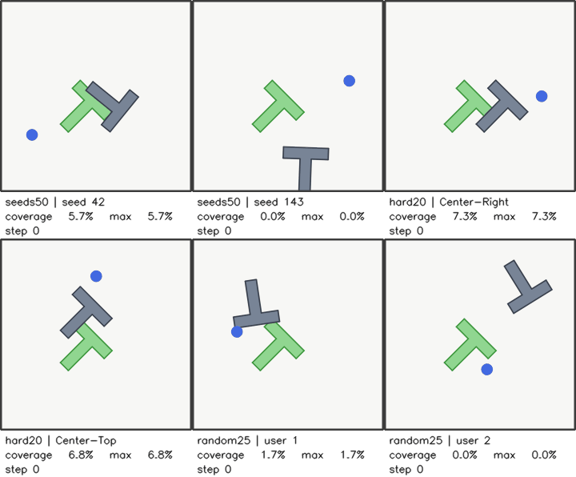
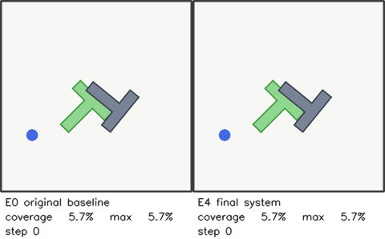
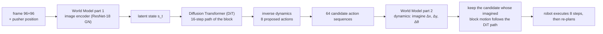

# Push-T: World Model + Diffusion Transformer

[](https://github.com/minhtri643/Push_T-/actions/workflows/smoke_test.yml) [](LICENSE) 

**English** · [Tiếng Việt](README_vi.md)

<p align="center"></p>

*The final system on six of the 95 benchmark starts: the first two successful episodes of each group, replayed exactly from the benchmark run. Green T: goal. Grey T: block. Blue dot: robot pusher. Blue line: block path planned by the diffusion transformer. Orange T: where the World Model imagines the block will be after the actions about to run. Over all 95 starts the success rate is 76% on this run and 71 ± 5% over three diffusion-noise draws (table below), so the GIF shows typical successes, not every episode.*

## The task

> Build a **World Model** that learns the rules of the interaction between a robot and an object: **from the current state and the robot's action, predict how the object's position changes.**
> Data: [lerobot/pusht](https://huggingface.co/datasets/lerobot/pusht). Pipeline: load data → simulation → train the World Model → train a diffusion model → evaluate.

**Push-T:** a round pusher must push a T-shaped block onto a fixed T-shaped goal. An episode succeeds when the block covers more than 95% of the goal within 300 steps.

**Training data:** only [lerobot/pusht](https://huggingface.co/datasets/lerobot/pusht), which has 206 human demonstrations and 25,650 frames. No other data and no pretrained weights are used for the final system. The simulator `gym_pusht/PushT-v0` is used only to **evaluate**.

## Results

<!-- RESULTS:START -->
95 paired starts, 300 steps, success = coverage > 0.95. All runs: [results/summary/benchmark_table.md](results/summary/benchmark_table.md).

| System | Uses at run time | Success [95% CI] | Mean max coverage | DP score |
|---|---|---|---|---|
| **`E4_final__dit_wm`** | image + pusher position + block pose from the simulator | 76% [66%–83%]; 71 ± 5% over 3 noise draws | 94.6% | 0.988 |
| `E4_final__dit_id` | same, without the World Model choosing the actions | 59% [49%–68%]; 55 ± 6% over 3 noise draws | 87.4% | 0.914 |
| `E5d_vjepa2_frozen__dit_id_vision` | image + pusher position only (block pose read from the image) | 54% [44%–63%]; 54 ± 2% over 3 noise draws | 85.4% | 0.894 |
| `E3_action_diffusion_baseline` | image + pusher position (Diffusion-Policy-style baseline, zarr data) | 32% [23%–41%] | 88.3% | 0.926 |
| `E0_baseline__dit_id` | the original version of this project | 2% [1%–7%] | 34.6% | 0.364 |

**Evolution of the project (best run of each stage)**

| Stage | Best run of the stage | Training data | Success | Mean max coverage |
|---|---|---|---|---|
| E0 — Original baseline | `E0_baseline__dit_id` | zarr | 2% | 34.6% |
| E1 — Evaluation protocol + augmentation fix | `E1_augfix__dit_id` | zarr | 41% | 77.3% |
| E2 — Hand-written controllers (archived) | `E2_tactical_no_lock` | zarr | 58% | 91.6% |
| E3 — Action-conditioned dynamics World Model (dit_wm) | `E3_augfix_ckpt__dit_wm` | zarr (+ simulator data for the dynamics) | 84% | 94.5% |
| E4 — Hugging Face data only (FINAL) | `E4_final__dit_wm` | lerobot/pusht only | 76% | 94.6% |
| E5 — Vision-only extension | `E5d_vjepa2_frozen__dit_id_vision` | lerobot/pusht only (+ frozen pretrained V-JEPA 2) | 54% | 85.4% |
<!-- RESULTS:END -->

<p align="center"></p>

*Same start (gym-pusht seed 42), same benchmark replay. Left: the original baseline E0 pushes the block away (max coverage 30%). Right: the final system E4 docks it at step 170.*

**How to read the tables:**
- **Statistics.** Every run uses the same 95 starts with the same random seeds, so runs are compared **pair by pair** (exact McNemar test). With 95 starts a success rate has a 95% interval of about ±9 points.
- **The World Model choosing the actions matters:** averaged over three diffusion-noise draws, 55% → 71% success. Per-start sign test over the three draws: p = 0.0001; on the first draw alone, 59% → 76%, McNemar p = 0.014.
- **The final system uses privileged information.** It reads the block pose from the simulator; the "vision only" row reads it from the image.
- **World Model accuracy.** On held-out demonstrations the dynamics World Model predicts the block 16 steps ahead with an error of **1.06 px / 0.63°**. Guessing "the block does not move" gives 25.6 px; the counterfactual sensitivity to the action is 96.5% (`results/world_model_eval/E4_final/`).
- **Published baselines, for context only.** LeRobot's Diffusion Policy reaches 71.0% success from keypoints (state) and 63.8% from images, over 500 episodes with other starts. On the 50 seeded gym-pusht starts our final system scores 78%, 70% and 66% over three noise draws (mean 71%). That is **comparable, not better**: one training seed, 64 candidate actions evaluated at run time, and privileged block pose.

## How it works



- **World Model, part 1: image encoder** (`pusht_wm_dit/models/world_model.py`). A ResNet-18 with GroupNorm encodes the frame and the pusher position into `s_t`. It is trained to decode the block pose and the pusher position from `s_t`.
- **World Model, part 2: dynamics** (`pusht_wm_dit/models/dynamics.py`). This is **the model the task asks for**.
  - It predicts the **change of the block pose** (Δx, Δy, Δθ) from the current state and the robot's actions.
  - It works in the block's own frame and is rolled out 16 steps open-loop.
  - It is trained with the course's displacement error f(Δx, Δy, Δθ).
- **Diffusion Transformer** (`pusht_wm_dit/models/dit_planner.py`). It diffuses the 16-step path of the block; DDIM with 10 steps; step 0 is pinned to the current pose by inpainting; the best of 8 samples is kept.
- **Inverse dynamics** (`pusht_wm_dit/models/inverse_dynamics.py`). It turns the path into robot actions.
- **The World Model chooses the actions** (`pusht_wm_dit/policy.py`, policy `dit_wm`). Each candidate is imagined with the dynamics model, and the one whose imagined block trajectory best matches the DiT path is executed.

**The dataset has no block pose.** lerobot/pusht contains frames, pusher positions and actions only. The pose is recovered from every frame by **render-and-compare** (`scripts/1_data/fit_block_pose.py`).
- Accuracy on simulator frames with known pose: 0.58 px / 0.17°.
- It is checked against the dataset's own reward: 97% of frames agree within 0.02.

Details: [experiments/E4_hf_only_final](experiments/E4_hf_only_final/README.md).

## Quickstart

Python 3.11. About 2 GB of packages; with an NVIDIA GPU, install `torch` from the [PyTorch index](https://pytorch.org) first.

```bash
git clone https://github.com/minhtri643/Push_T-.git
cd Push_T-
python -m venv .venv
# Linux / macOS: source .venv/bin/activate      Windows: .venv\Scripts\activate
pip install -r requirements.txt
python scripts/download_assets.py          # trained final system, ~90 MB, SHA-256 checked
```

| Command | What it does | Time (RTX 3050 / CPU) |
|---|---|---|
| `python demo.py` | Interactive demo. Drag the T, press Space. M = World Model chooses actions, V = vision only, G = show the imagination. | real time |
| `python scripts/5_evaluation/benchmark.py --policy dit_wm --label my_run` | Re-runs the 95-start benchmark of the final system; should reproduce `E4_final__dit_wm` (76%). | ~3 min / longer on CPU |
| `python scripts/5_evaluation/make_video.py grid` | Re-creates the GIF above from the benchmark episodes. | ~2 min |
| `python scripts/5_evaluation/summarize_results.py` | Rebuilds every results table from the raw JSON files. | seconds |

## Reproduce everything from scratch

Run the steps one at a time; each one needs a GPU (4 GB is enough).

```bash
python scripts/1_data/download_dataset.py                 # lerobot/pusht from Hugging Face (7.7 MB)
python scripts/1_data/fit_block_pose.py hf                # block pose from the frames -> data/pusht_hf.zarr (~16 min)
python scripts/1_data/fit_block_pose.py synthetic         # (optional) accuracy of the pose recovery on simulator frames
python scripts/2_simulation/check_simulator.py            # (optional) simulator sanity check
python scripts/3_world_model/train_encoder.py             # World Model part 1 + latent cache (~11 min)
python scripts/3_world_model/train_dynamics.py            # World Model part 2: dynamics (~4 min)
python scripts/3_world_model/evaluate_world_model.py      # 16-step prediction error, counterfactual test
python scripts/4_diffusion/train_dit_planner.py           # DiT + inverse dynamics (~27 min)
python scripts/5_evaluation/benchmark.py --policy dit_wm --label E4_final__dit_wm
python scripts/6_vision_world_model/train_jepa_wm.py      # (extension E5) vision World Model, self-trained encoder (~53 min)
python scripts/6_vision_world_model/train_frozen_encoder_wm.py --encoder vjepa2   # (E5) frozen V-JEPA 2 (~47 min)
```

To skip the slow pose recovery, `python scripts/download_assets.py --what data` downloads the processed dataset.
Models of every earlier stage: `--what history`. Vision World Models: `--what vision`.

## Repository map

| Path | Content |
|---|---|
| `pusht_wm_dit/` | The library: `data/` (dataset, pose recovery), `envs/` (simulator wrapper), `models/` (World Model, dynamics, DiT, inverse dynamics, vision World Models), `policy.py` (all policies + closed-loop rollout), `paths.py`. |
| `scripts/1_data` … `scripts/6_vision_world_model` | The pipeline, in the order of the task. |
| `demo.py` | Interactive demo. |
| `configs/default.yaml` | Every hyper-parameter and path. |
| `experiments/E0_…` … `E5_…` | **History of the project**: what was tried at each stage, why, the numbers, and the lessons. Start with [experiments/README.md](experiments/README.md). |
| `results/` | Every measured number. `benchmark/` (one JSON per run, 95 episodes each), `summary/` (tables), `world_model_eval/`, `pose_recovery/`, `vision_world_models/`, `training_logs/`, `legacy_protocol/`. |
| `docs/` | Media, figures, `name_mapping.md` (old → new names), `provenance/` (reorganisation log), `README_FOR_AI.md` (full technical context). |
| `checkpoints/`, `data/` | Not in git; filled by `scripts/download_assets.py` and the data scripts. |

## Limitations

- **Privileged block pose.** The final system (76%) reads the block pose from the simulator at run time. Vision-only versions reach 45–54% ([E5](experiments/E5_vision_world_models/README.md)).
- **Choosing actions with a vision World Model hurts.** With an image-feature World Model (DINO-WM style) as the action selector, success drops to 11–20% for every encoder tried: its ~10 px errors are too coarse to rank candidate actions.
- **Fixed goal.** The goal is the same in all 206 demonstrations, so the system has never learned to push to another goal.
- **Small statistics.** One training seed. 95 benchmark starts give ±9-point intervals; diffusion-noise repeats are reported where available.
- **Compression mismatch.** The pose-recovery accuracy was measured on frames compressed with libaom; LeRobot used libsvtav1. The compression level is similar but not identical.

## License and data

Code: MIT ([LICENSE](LICENSE)).
- Data: [lerobot/pusht](https://huggingface.co/datasets/lerobot/pusht) (LeRobot / Hugging Face).
- Simulator: [gym-pusht](https://github.com/huggingface/gym-pusht).
- Frozen encoders of the E5 extension: DINOv2 and V-JEPA 2 (Meta). Each is under its own license.
