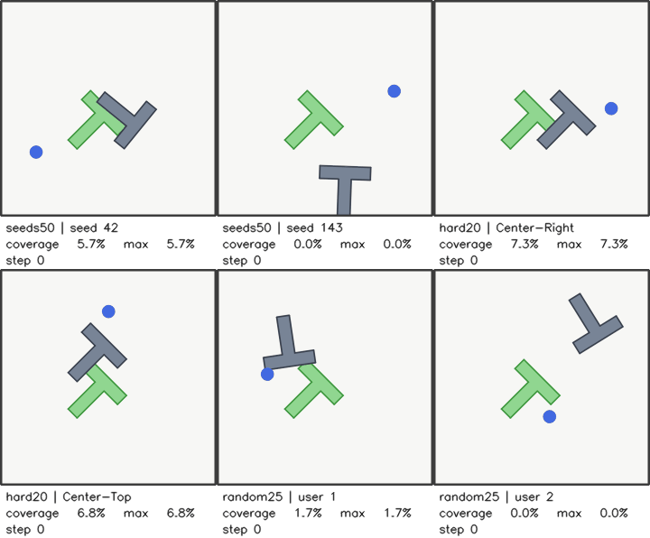
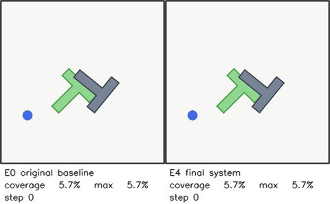
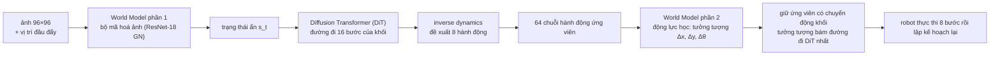

# Push-T: World Model + Diffusion Transformer

[](https://github.com/minhtri643/Push_T-/actions/workflows/smoke_test.yml) [](LICENSE) 

[English](README.md) · **Tiếng Việt**

<p align="center"></p>

*Hệ thống cuối trên 6 trong 95 điểm xuất phát của benchmark: hai ván thành công đầu tiên của mỗi nhóm, phát lại y hệt từ lần chạy benchmark.*
- *Chữ T xanh lá: ô đích. Chữ T xám: khối. Chấm xanh dương: đầu đẩy của robot.*
- *Đường xanh: đường đi của khối do diffusion transformer lập kế hoạch. Chữ T cam: vị trí World Model tưởng tượng khối sẽ tới sau các hành động sắp chạy.*

*Trên cả 95 điểm xuất phát, tỉ lệ thành công là 76% ở lần chạy này và 71 ± 5% qua ba lần lặp nhiễu khuếch tán (bảng dưới), nên GIF cho thấy các ván thành công điển hình, không phải mọi ván.*

## Đề bài

> Xây dựng **World Model** để học quy luật tương tác giữa robot và vật thể: **từ trạng thái hiện tại và hành động của robot, mô hình dự đoán sự thay đổi vị trí vật thể.**
> Dữ liệu: [lerobot/pusht](https://huggingface.co/datasets/lerobot/pusht). Pipeline: tải dữ liệu → mô phỏng → học World Model → học mô hình khuếch tán → đánh giá.

**Push-T:** một đầu đẩy tròn phải đẩy khối hình chữ T vào ô đích hình chữ T cố định. Thành công khi khối phủ hơn 95% ô đích trong 300 bước.

**Dữ liệu học:** chỉ [lerobot/pusht](https://huggingface.co/datasets/lerobot/pusht), gồm 206 lần trình diễn của người và 25.650 khung hình. Hệ thống cuối không dùng dữ liệu nào khác, không dùng trọng số tiền huấn luyện. Bộ mô phỏng `gym_pusht/PushT-v0` chỉ dùng để **đánh giá**.

## Kết quả

<!-- RESULTS:START -->
95 điểm xuất phát ghép cặp, 300 bước, thành công = độ phủ > 0,95. Mọi lần chạy: [results/summary/benchmark_table_vi.md](results/summary/benchmark_table_vi.md).

| Hệ thống | Dùng lúc chạy | Thành công [KTC 95%] | Độ phủ TB | Điểm DP |
|---|---|---|---|---|
| **`E4_final__dit_wm`** | ảnh + vị trí đầu đẩy + tư thế khối từ mô phỏng | 76% [66%–83%]; 71 ± 5% qua 3 lần lặp nhiễu | 94.6% | 0.988 |
| `E4_final__dit_id` | như trên, không có World Model chọn hành động | 59% [49%–68%]; 55 ± 6% qua 3 lần lặp nhiễu | 87.4% | 0.914 |
| `E5d_vjepa2_frozen__dit_id_vision` | chỉ ảnh + vị trí đầu đẩy (tư thế khối đọc từ ảnh) | 54% [44%–63%]; 54 ± 2% qua 3 lần lặp nhiễu | 85.4% | 0.894 |
| `E3_action_diffusion_baseline` | ảnh + vị trí đầu đẩy (baseline kiểu Diffusion Policy, dữ liệu zarr) | 32% [23%–41%] | 88.3% | 0.926 |
| `E7_jepa_dit` | ảnh + vị trí đầu đẩy, bộ mã hoá JEPA hoàn toàn tự giám sát | 32% [23%–41%]; 30 ± 3% qua 3 lần lặp nhiễu | 72.1% | 0.756 |
| `E6a_resnet_spatial_direct` | ảnh + vị trí đầu đẩy, ResNet-18 học đầu-cuối, khuếch tán trực tiếp hành động | 17% [11%–26%] | 45.3% | 0.475 |
| `E0_baseline__dit_id` | phiên bản đầu tiên của dự án | 2% [1%–7%] | 34.6% | 0.364 |

**Tiến hoá của dự án (lần chạy tốt nhất mỗi giai đoạn)**

| Giai đoạn | Lần chạy tốt nhất của giai đoạn | Dữ liệu học | Thành công | Độ phủ TB |
|---|---|---|---|---|
| E0 — Bản gốc | `E0_baseline__dit_id` | zarr | 2% | 34.6% |
| E1 — Sửa giao thức đánh giá + augmentation | `E1_augfix__dit_id` | zarr | 41% | 77.3% |
| E2 — Bộ điều khiển viết tay (đã lưu trữ) | `E2_tactical_no_lock` | zarr | 58% | 91.6% |
| E3 — World Model động lực học theo hành động (dit_wm) | `E3_augfix_ckpt__dit_wm` | zarr (+ dữ liệu mô phỏng cho động lực học) | 84% | 94.5% |
| E4 — Chỉ dữ liệu Hugging Face (BẢN CUỐI) | `E4_final__dit_wm` | chỉ lerobot/pusht | 76% | 94.6% |
| E5 — Nhánh mở rộng chỉ dùng ảnh | `E5d_vjepa2_frozen__dit_id_vision` | chỉ lerobot/pusht (+ V-JEPA 2 tiền huấn luyện, đóng băng) | 54% | 85.4% |
| E6 — Chính sách khuếch tán ảnh đầu-cuối (không inverse dynamics) | `E6a_resnet_spatial_direct` | chỉ lerobot/pusht | 17% | 45.3% |
| E7 — World Model JEPA tự giám sát + DiT | `E7_jepa_dit` | chỉ lerobot/pusht | 32% | 72.1% |
<!-- RESULTS:END -->

<p align="center"></p>

*Cùng điểm xuất phát (seed 42 của gym-pusht), phát lại đúng ván benchmark. Trái: bản gốc E0 đẩy khối lệch đi (độ phủ cao nhất 30%). Phải: hệ thống cuối E4 đưa khối vào đích ở bước 170.*

**Cách đọc bảng:**
- **Thống kê.** Mọi lần chạy dùng cùng 95 điểm xuất phát và cùng seed, nên so sánh được **theo từng cặp** (kiểm định McNemar chính xác). Với 95 điểm xuất phát, khoảng tin cậy 95% của tỉ lệ thành công rộng khoảng ±9 điểm.
- **World Model chọn hành động là yếu tố quan trọng:** trung bình qua ba lần lặp nhiễu, thành công 55% → 71%. Kiểm định dấu theo từng điểm xuất phát qua cả ba lần: p = 0,0001; riêng lần đầu 59% → 76%, McNemar p = 0,014.
- **Hệ thống cuối dùng thông tin đặc quyền.** Nó đọc tư thế khối từ mô phỏng; dòng "chỉ dùng ảnh" đọc tư thế từ ảnh.
- **Độ chính xác của World Model.** Trên các lần trình diễn giữ lại, World Model động lực học dự đoán khối sau 16 bước lệch **1,06 px / 0,63°**. Đoán "khối đứng yên" lệch 25,6 px; độ nhạy với hành động là 96,5%.
- **Kết quả công bố, chỉ để tham khảo.** Diffusion Policy của LeRobot đạt 71,0% từ keypoint (trạng thái) và 63,8% từ ảnh, trên 500 ván với điểm xuất phát khác. Trên 50 seed gym-pusht, hệ thống cuối đạt 78%, 70% và 66% qua ba lần lặp nhiễu (trung bình 71%). Như vậy là **tương đương, không tốt hơn**: mới có 1 seed huấn luyện, phải tính 64 ứng viên lúc chạy, và dùng tư thế khối đặc quyền.

## Hệ thống hoạt động thế nào



- **World Model phần 1: bộ mã hoá ảnh.** ResNet-18 + GroupNorm nén ảnh và vị trí đầu đẩy thành `s_t`, được học để giải mã lại tư thế khối và vị trí đầu đẩy.
- **World Model phần 2: động lực học.** Đây là **mô hình mà đề bài yêu cầu**.
  - Dự đoán **độ thay đổi tư thế khối** (Δx, Δy, Δθ) từ trạng thái hiện tại và hành động.
  - Làm việc trong hệ toạ độ của khối, lăn 16 bước liền không cần quan sát.
  - Học bằng sai số dịch chuyển f(Δx, Δy, Δθ) của đề bài.
- **Diffusion Transformer.** Khuếch tán đường đi 16 bước của khối; DDIM 10 bước; bước 0 được ghim vào tư thế hiện tại; chọn 1 trong 8 mẫu.
- **Inverse dynamics.** Biến đường đi thành hành động của robot.
- **World Model chọn hành động** (policy `dit_wm`). Mỗi ứng viên được tưởng tượng bằng mô hình động lực học; ứng viên bám đường đi DiT nhất được thực thi.

**Bộ dữ liệu không có tư thế khối.** Tư thế được khôi phục từ từng khung bằng **render-and-compare**, tức vẽ khối ở tư thế thử rồi so với ảnh và chỉnh dần tới khi khớp.
- Độ chính xác trên ảnh mô phỏng biết trước tư thế: 0,58 px / 0,17°.
- Kiểm chứng bằng chính reward của bộ dữ liệu: 97% số khung khớp trong phạm vi 0,02.

Chi tiết: [experiments/E4_hf_only_final](experiments/E4_hf_only_final/README.md).

## Chạy nhanh

Cần Python 3.11 và khoảng 2 GB thư viện. Nếu có GPU NVIDIA, cài `torch` từ [trang PyTorch](https://pytorch.org) trước.

```bash
git clone https://github.com/minhtri643/Push_T-.git
cd Push_T-
python -m venv .venv
# Linux / macOS: source .venv/bin/activate      Windows: .venv\Scripts\activate
pip install -r requirements.txt
python scripts/download_assets.py          # mô hình cuối, ~90 MB, có kiểm tra SHA-256
```

| Lệnh | Làm gì | Thời gian (RTX 3050 / CPU) |
|---|---|---|
| `python demo.py` | Demo tương tác: kéo khối T, nhấn Space. M = World Model chọn hành động, V = chỉ dùng ảnh, G = hiện dự đoán. | thời gian thực |
| `python scripts/5_evaluation/benchmark.py --policy dit_wm --label my_run` | Chạy lại benchmark 95 điểm xuất phát của hệ thống cuối. Trên GPU, ra lại đúng `E4_final__dit_wm` (76%) từng ván. Trên CPU, nhiễu khuếch tán khác (bộ sinh số ngẫu nhiên khác) nên giống một lần lặp nhiễu mới: cài sạch chỉ có CPU cho 72%. | ~3 phút GPU / ~6 phút CPU |
| `python scripts/5_evaluation/make_video.py grid` | Tạo lại GIF ở trên bằng cách phát lại các ván benchmark (chính xác trên GPU). | ~2 phút |
| `python scripts/5_evaluation/summarize_results.py` | Dựng lại mọi bảng kết quả từ file JSON gốc. | vài giây |

## Chạy lại toàn bộ từ đầu

Xem các lệnh ở [README tiếng Anh](README.md#reproduce-everything-from-scratch). Thứ tự đúng theo đề bài:
1. `1_data`: tải dữ liệu, khôi phục tư thế khối.
2. `2_simulation`: kiểm tra bộ mô phỏng.
3. `3_world_model`: học World Model.
4. `4_diffusion`: học DiT và inverse dynamics.
5. `5_evaluation`: đánh giá.
6. `6_vision_world_model`: nhánh mở rộng chỉ dùng ảnh (E5).
7. `7_end2end_vision_diffusion`: chính sách khuếch tán ảnh đầu-cuối (E6).

E7 (JEPA tự giám sát + DiT) có pipeline riêng, khoảng 80 phút: xem [experiments/E7_self_supervised_jepa_dit](experiments/E7_self_supervised_jepa_dit/README.md).

## Bản đồ thư mục

| Đường dẫn | Nội dung |
|---|---|
| `pusht_wm_dit/` | Thư viện: dữ liệu, khôi phục tư thế, bộ mô phỏng, các mô hình, policy và vòng kín. |
| `scripts/1_data` … `scripts/7_end2end_vision_diffusion` | Pipeline theo thứ tự đề bài (6 và 7: hai nhánh chỉ dùng ảnh E5 và E6). |
| `demo.py` | Demo tương tác. |
| `configs/default.yaml` | Mọi siêu tham số và đường dẫn. |
| `experiments/E0_…` … `E7_…` | **Lịch sử dự án**: mỗi giai đoạn đã thử gì, vì sao, số liệu và bài học. Bắt đầu từ [experiments/README.md](experiments/README.md). E7 là nhánh tự giám sát được phát triển song song rồi gộp vào dự án. |
| `results/` | Mọi con số đã đo: `benchmark/` (mỗi lần chạy một file JSON 95 ván), `summary/` (bảng), đánh giá World Model, khôi phục tư thế, log huấn luyện. |
| `docs/` | Video, hình, bảng đối chiếu tên cũ → mới, nhật ký sắp xếp lại, tài liệu kỹ thuật đầy đủ. |
| `checkpoints/`, `data/` | Không nằm trong git; tải bằng `scripts/download_assets.py` và các script dữ liệu. |

## Hạn chế

- **Tư thế khối đặc quyền.** Hệ thống cuối (76%) đọc tư thế khối từ mô phỏng lúc chạy. Bản chỉ dùng ảnh đạt 45–54% ([E5](experiments/E5_vision_world_models/README.md)).
- **Policy sinh hành động trực tiếp từ ảnh còn thấp.** Khuếch tán thẳng hành động từ ảnh, không qua đường đi của khối và inverse dynamics, đạt 17% khi học đầu-cuối ([E6](experiments/E6_end2end_vision_diffusion/README.md)), 30 ± 3% với bộ mã hoá JEPA tự giám sát ([E7](experiments/E7_self_supervised_jepa_dit/README.md)) và 32% với baseline E3, đều thấp hơn E5 (p ≤ 0,01). Với lượng dữ liệu và cỡ mô hình này, tách bài toán thành đường đi của khối và inverse dynamics mới hiệu quả.
- **World Model ảnh làm hại khi dùng để chọn hành động.** Dùng World Model trên đặc trưng ảnh (kiểu DINO-WM) để chọn hành động làm thành công tụt còn 11–20% với mọi bộ mã hoá đã thử: sai số khoảng 10 px quá thô để xếp hạng các hành động ứng viên.
- **Đích cố định.** Đích giống nhau trong cả 206 lần trình diễn, nên hệ thống chưa từng học đẩy tới đích khác.
- **Thống kê còn ít.** Mới có 1 seed huấn luyện; 95 điểm xuất phát cho khoảng tin cậy ±9 điểm.
