# Latent JEPA World Model và Diffusion Transformer cho bài toán PushT

**Họ tên, MSSV, môn học:** [điền]  |  **Mã nguồn, log, video demo:** https://github.com/minhtri643/Push_T (thư mục experiments/E7_self_supervised_jepa_dit)

## Tóm tắt

Báo cáo xây dựng một hệ điều khiển PushT đi thẳng từ ảnh camera 96×96, không dùng tọa độ vật thể làm đầu vào. Khối thứ nhất là một world model kiểu JEPA (2,17 triệu tham số) học tự giám sát bằng cách dự đoán biểu diễn ẩn của các khung tương lai, sau đó được đóng băng. Khối thứ hai là Diffusion Transformer (1,36 triệu tham số) sinh quỹ đạo 2 giây của pusher với điều kiện là vector trạng thái ẩn. Trên 375 mẫu validation, sai số vị trí cuối quỹ đạo của vật thể (FDE$_{obj}$) là 37,2, thấp hơn baseline ngoại suy vận tốc (44,6) và baseline đứng yên (51,5). Trong mô phỏng vòng kín, hệ đạt 26% thành công (13/50 seed, ngưỡng coverage 0,95) và 25% trên 20 seed độc lập (5/20). Thay encoder bằng bản khởi tạo ngẫu nhiên làm success về 0%, đây là bằng chứng mạnh nhất rằng mục tiêu JEPA học được thông tin hữu ích. Kết quả thấp hơn Diffusion Policy gốc (65,4%) và báo cáo nêu rõ các giả thuyết về nguyên nhân, chưa kiểm chứng.

# Chương 1. Giới thiệu

## 1.1 Bài toán PushT

PushT là bài toán điều khiển 2D: một pusher hình tròn đẩy khối chữ T trên mặt phẳng sao cho khối T trùng với vị trí đích cố định (vùng xanh). Quan sát gồm ảnh 96×96 và tọa độ pusher; hành động là vị trí đích 2 chiều của pusher, được bộ điều khiển PD của mô phỏng kéo tới. Nhiệm vụ thành công khi diện tích khối T phủ lên vùng đích (coverage) đạt ít nhất 0,95.

## 1.2 Vì sao bài toán khó

Hai đặc điểm làm PushT khó với imitation learning thông thường. Thứ nhất, **động lực tiếp xúc** (ma sát, va chạm) khiến chuyển động của khối T chỉ được xác định khi pusher đã chạm vào nó, và một sai lệch nhỏ khi đẩy làm đổi hẳn tư thế sau đó. Thứ hai, **đa phương thức**: từ cùng một trạng thái có nhiều cách tiếp cận hợp lý (vòng bên trái hoặc bên phải khối T), nên một chính sách học bằng hồi quy dễ trung bình hóa các cách đó.

## 1.3 Mục tiêu và đóng góp

Đề bài yêu cầu một world model học trong không gian ẩn rồi dùng nó điều kiện hóa một chính sách khuếch tán. Báo cáo trình bày ba phần:

1. Một **JEPA world model** tự giám sát, huấn luyện từ ảnh và hành động, rồi đóng băng để xuất trạng thái ẩn $S_t$.
2. Một **Diffusion Transformer (DiT)** học khử nhiễu quỹ đạo tương lai của pusher với điều kiện $S_t$.
3. Một **quy trình đánh giá** gồm FDE offline trên tư thế vật thể, mô phỏng vòng kín và các ablation, kèm thống kê và khoảng tin cậy để phân biệt khác biệt thật với nhiễu.

## 1.4 Ràng buộc

Toàn bộ thí nghiệm chạy trên một GPU GTX 1650 (4 GB, fp32). Hai mô hình nhỏ (2,17 và 1,36 triệu tham số), world model huấn luyện khoảng 1,5 giờ, DiT khoảng 29 phút. Ràng buộc này quyết định nhiều lựa chọn thiết kế, và là một lý do cần thận trọng khi so với các hệ thống lớn hơn.

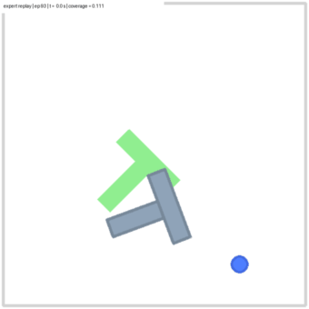

*Hình 1.1. Một khung mô phỏng PushT: pusher (chấm xanh dương), khối T (xám xanh) và vùng đích (xanh lá).*

# Chương 2. Dữ liệu, mô phỏng và thước đo

## 2.1 Dữ liệu

Dữ liệu là `lerobot/pusht`: 206 tập demo của người, tổng 25 650 khung ở 10 fps (độ dài tập từ 49 đến 246 khung, trung bình 124,5). Mỗi khung gồm ảnh 96×96, tọa độ pusher và hành động. Tập dữ liệu chia **theo tập** thành 186 tập huấn luyện và 20 tập validation (seed 42). Chia theo khung sẽ làm lọt dữ liệu giữa các clip chồng lấn của cùng một tập.

Tư thế khối T $(x, y, \theta)$ lấy từ bản gốc dạng zarr và chỉ dùng để **đánh giá** (probe tuyến tính, FDE). Nó không phải đầu vào của bất kỳ mô hình nào, đúng với yêu cầu học từ ảnh. Bản lerobot và bản zarr khớp hoàn toàn về trạng thái và hành động (sai khác lớn nhất bằng 0); ảnh khác nhau trung bình 0,68/255 do ép kiểu float sang uint8.

## 2.2 Mô phỏng

Mô phỏng dùng gym-pusht 0.1.8 (pymunk 6.11.1, tất định). Hai phát hiện kỹ thuật cần ghi nhận:

- Hàm đặt lại trạng thái phải nạp **góc trước, vị trí sau**. Thứ tự ngược lại (mặc định của thư viện) làm khối T lệch khoảng 90 px, và khi đặt khối T đúng tư thế đích chỉ cho coverage 0,15 thay vì 1,00. Với thứ tự đúng, replay lại demo của người cho sai lệch 0,000 px ở cả bước đầu và bước cuối.
- Tọa độ pixel là $u = 96x/512$, $v = 96y/512$, không đảo trục y (sai số 0,45 px so với 33,6 px nếu đảo).

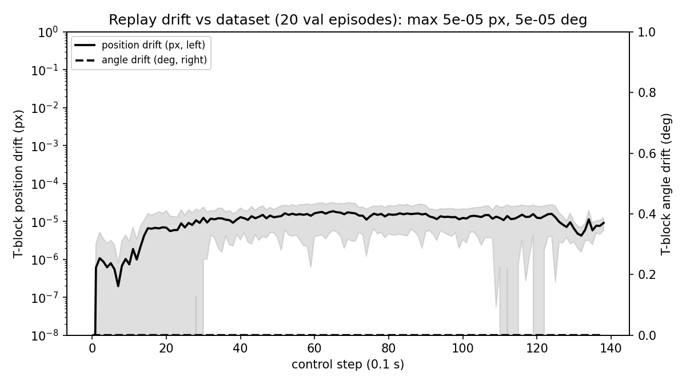

*Hình 2.1. Sai lệch giữa mô phỏng và bản ghi khi replay demo của người: bằng không tại mọi bước, nên mô phỏng tái hiện chính xác dữ liệu.*

## 2.3 Demo của người không đạt ngưỡng 0,95

Replay 20 tập validation cho **0/20 tập đạt coverage 0,95** (10/20 đạt 0,90, mean max coverage 0,898). Trên cả 206 tập, coverage cuối có median 0,897 (từ 0,861 đến 0,966) và chỉ 7 tập vượt 0,95. Nói cách khác, người làm demo thường dừng ở khoảng 0,90 chứ không căn khít hoàn toàn. Đây không phải lỗi của mô phỏng: nó khớp phần thưởng ghi trong dữ liệu với sai số 0,0007. Hệ quả cho thước đo: ngưỡng 0,95 khắt khe hơn chính các demo mà mô hình học theo.

## 2.4 Thước đo

| Thước đo | Ý nghĩa |
|---|---|
| FDE$_{pos}$, FDE$_\theta$, FDE$_{obj}$ | Sai số tư thế khối T sau 2 s khi chạy path dự đoán trong sim so với path của người (mục 3.7) |
| minFDE@5 | FDE của mẫu tốt nhất trong 5 mẫu |
| Success@0,95 | Tỷ lệ tập đạt coverage ≥ 0,95 (chuẩn gym-pusht, so được với LeRobot) |
| Success@0,90 | Mức coverage mà chính demo của người đạt |
| Mean max coverage | Trung bình coverage lớn nhất mỗi tập (thước đo chính của Diffusion Policy) |
| Thời gian hoàn thành, độ trễ | Giây tới khi thành công (chỉ tính tập thành công, giới hạn 30 s); ms mỗi lần suy luận |

*Bảng 2.1. Mốc tham chiếu.*

| Hệ | Success@0,95 | Success@0,90 | Mean max coverage |
|---|---|---|---|
| Tác tử ngẫu nhiên (10 tập) | 0/10 | - | 0,070 |
| Replay demo người (20 tập val) | 0/20 | 10/20 | 0,898 |
| Diffusion Policy trong LeRobot (tham chiếu, mô hình lớn hơn, huấn luyện khác) | 65,4% | - | 0,955 |

# Chương 3. Phương pháp

Hệ thống gồm hai khối được huấn luyện tách rời (Hình 3.1). **Khối 1** là world model kiểu JEPA, học tự giám sát từ ảnh. Sau khi hội tụ, toàn bộ trọng số được đóng băng và mỗi khung ảnh được mã hóa thành vector trạng thái ẩn $S_t \in \mathbb{R}^{256}$. **Khối 2** là Diffusion Transformer (DiT), học khử nhiễu quỹ đạo 2 giây tương lai của pusher với điều kiện là $S_t$. Trong vòng điều khiển chỉ có encoder của khối 1 và DiT tham gia. Bộ dự đoán động lực của khối 1 chỉ đóng vai trò tín hiệu huấn luyện cho encoder; điểm này quan trọng khi diễn giải kết quả ở Chương 6.

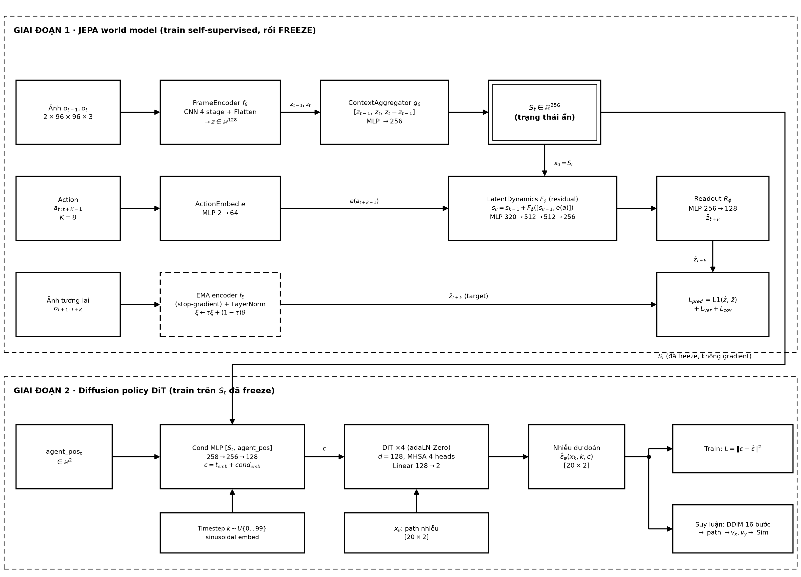

*Hình 3.1. Kiến trúc tổng thể. Khối 1 huấn luyện trước rồi đóng băng; khối 2 huấn luyện trên $S_t$ đã xuất sẵn. Hộp nét đứt là encoder EMA (stop-gradient).*

## 3.1 Vì sao chọn latent JEPA thay vì đo tọa độ tường minh

**Tọa độ tường minh không có sẵn ngoài mô phỏng.** Cách tiếp cận state-based giả định biết chính xác tư thế $(x, y, \theta)$ của khối T ở mọi thời điểm. Trên robot thật, thông tin này cần marker, hệ motion capture hoặc một bộ ước lượng tư thế riêng. Đề bài yêu cầu đi thẳng từ ảnh camera, nên bài toán trở thành: học từ ảnh một biểu diễn chứa đủ thông tin để điều khiển.

**Dự đoán trong không gian ẩn thay vì tái tạo pixel.** Có hai họ phương pháp học biểu diễn tự giám sát từ ảnh. Họ tái tạo (autoencoder, VAE) học bằng cách vẽ lại ảnh, nên hàm mất mát tính trên từng pixel. Ảnh PushT 96×96 chủ yếu là nền; trong khi đó vài pixel lệch của khối T, vốn quyết định thành bại của nhiệm vụ, chỉ chiếm phần rất nhỏ của hàm mất mát. Họ JEPA [2], [3] chỉ yêu cầu dự đoán **biểu diễn** của khung tương lai từ biểu diễn hiện tại và hành động. Encoder vì vậy không cần giữ chi tiết không dự đoán được, mà bị ép giữ lại những đại lượng quyết định tương lai: vị trí, góc và vận tốc của pusher và khối T.

**Góc nhìn không gian trạng thái.** Với người làm điều khiển, khối 1 tương đương một mô hình hộp đen dạng
$x_{k} = x_{k-1} + f(x_{k-1}, u_{k-1})$, $y_k = h(x_k)$,
trong đó cả không gian trạng thái lẫn đầu ra đều được học: $S_t$ đóng vai trò trạng thái ước lượng từ hai khung ảnh (giống một bộ quan sát), bộ dự đoán là hàm chuyển trạng thái dạng Euler rời rạc, và readout là mô hình quan sát. Hành động chỉ đi vào bộ dự đoán, không đi vào encoder, nên $S_t$ chỉ phụ thuộc ảnh, đúng yêu cầu đầu vào là chuỗi khung hình.

**Bằng chứng thực nghiệm** (chi tiết ở Chương 4): probe tuyến tính trên $S_t$ khôi phục vị trí khối T với $R^2 = 0{,}904$, cao hơn PCA 256 chiều trên pixel (0,821) và encoder cùng kiến trúc nhưng khởi tạo ngẫu nhiên (0,687). Sai số góc là 18,5° so với 42,8° (PCA) và 40,5° (ngẫu nhiên).

## 3.2 Kiến trúc world model

**Đầu vào** là hai khung liên tiếp $o_{t-1}, o_t$ (96×96×3). **FrameEncoder** $f_\theta$ là CNN gồm 4 tầng tích chập bước 2 (96 → 48 → 24 → 12 → 6), GroupNorm, kết thúc bằng flatten và một lớp tuyến tính ra $z_t \in \mathbb{R}^{128}$. Không dùng global average pooling vì phép này xóa thông tin vị trí không gian, vốn là thông tin quan trọng nhất của PushT. **ContextAggregator** $g_\theta$ nhận $[z_{t-1}, z_t, z_t - z_{t-1}]$ qua MLP và LayerNorm để ra $S_t \in \mathbb{R}^{256}$. Thành phần hiệu $z_t - z_{t-1}$ cung cấp thông tin vận tốc, thứ một khung ảnh đơn lẻ không quan sát được.

**Bộ dự đoán động lực** cuộn $K = 8$ bước dạng phần dư: $s_0 = S_t$, $s_k = s_{k-1} + F_\phi([s_{k-1}, e(a_{t+k-1})])$, rồi readout $\hat z_{t+k} = R_\phi(s_k)$. **Mục tiêu** là $\bar z_{t+k} = \mathrm{LN}(f_\xi(o_{t+k}))$, với $f_\xi$ là bản trung bình trượt (EMA) của encoder, không truyền gradient, hệ số $\tau$ tăng theo cosine từ 0,99 đến 0,999. Hàm mất mát:

$$
\mathcal{L}_{WM} = \underbrace{\frac{\sum_k m_k \lVert \hat z_{t+k} - \bar z_{t+k} \rVert_1}{\sum_k m_k}}_{\mathcal{L}_{pred}} + \lambda_{var}\big[\mathcal{L}_{var}(S) + \mathcal{L}_{var}(z)\big] + \lambda_{cov}\,\mathcal{L}_{cov}(S) \tag{3.1}
$$

với $m_k$ là mặt nạ bước hợp lệ (cuối tập), $\lambda_{var} = 1$, $\lambda_{cov} = 0{,}04$. Tổng số tham số huấn luyện là 2,17 triệu.

**Dữ liệu huấn luyện** là các clip chồng lấn với bước trượt 1 khung, nên mỗi khung là một mẫu (khoảng 25 nghìn mẫu từ 206 tập). Tập dữ liệu chia **theo tập** thành 186 tập train và 20 tập val (seed 42), vì chia theo khung sẽ làm rò rỉ dữ liệu giữa các clip chồng lấn. Tăng cường dữ liệu bằng dịch ngẫu nhiên ±4 px, dùng chung một độ dịch cho mọi khung của cùng mẫu để không tạo chuyển động giả. Tối ưu bằng AdamW (lr $3\cdot10^{-4}$, weight decay 0,05, batch 64, warmup 2 epoch rồi cosine). Mô hình chạy 36 epoch trên GTX 1650 (fp32, khoảng 150 s/epoch). Kế hoạch là 40 epoch nhưng dừng tay ở epoch 36 khi learning rate chỉ còn khoảng 3% giá trị đỉnh.

## 3.3 Chống sụp biểu diễn và đóng băng

Hàm $\mathcal{L}_{pred}$ có một nghiệm tầm thường: encoder xuất cùng một vector cho mọi ảnh thì sai số dự đoán bằng 0. Encoder mục tiêu EMA và stop-gradient [8] làm giảm nguy cơ này nhưng không loại bỏ hoàn toàn. Vì vậy ta thêm hai số hạng của VICReg [9]: $\mathcal{L}_{var}$ phạt mọi chiều có độ lệch chuẩn trong batch nhỏ hơn 1, và $\mathcal{L}_{cov}$ phạt tương quan giữa các chiều. Hiện tượng sụp được theo dõi bằng độ lệch chuẩn trung bình theo chiều của $S_t$ và hạng hiệu dụng (effective rank) của ma trận $S_t$.

Sau huấn luyện, world model được **đóng băng**, vì ba lý do. Thứ nhất, đây là yêu cầu của đề. Thứ hai, biểu diễn cố định giúp quy kết rõ ràng: mọi khác biệt ở khối 2 đến từ policy, không phải từ việc encoder thay đổi. Thứ ba, $S_t$ được xuất một lần cho toàn bộ 25 650 khung, gồm 1 bản sạch và 4 bản dịch ngẫu nhiên làm tăng cường, nên DiT huấn luyện trên vector chỉ mất khoảng 29 phút. Tổng trị tuyệt đối mọi tham số (checksum) của world model được kiểm tra trước và sau khi huấn luyện DiT để xác nhận trọng số không đổi.

## 3.4 Vì sao chọn DiT khử nhiễu thay vì behavior cloning hồi quy

**PushT là bài toán đa phương thức.** Từ cùng một trạng thái, người làm demo có thể vòng bên trái hoặc bên phải khối T để tới điểm đẩy. Behavior cloning hồi quy với hàm mất mát bình phương học kỳ vọng có điều kiện $\mathbb{E}[\text{path} \mid S_t]$. Khi phân phối có hai mode, kỳ vọng rơi vào giữa, thường là một đường đâm thẳng vào khối T và không thuộc mode nào. Mô hình khuếch tán học score của phân phối có điều kiện $p(\text{path} \mid S_t)$, nên mỗi lần lấy mẫu sẽ cho một quỹ đạo thuộc một mode cụ thể [1].

**Tính tự giám sát.** Mục tiêu học là dự đoán lại nhiễu Gaussian do chính quá trình huấn luyện thêm vào quỹ đạo demo. Mô hình không cần nhãn nào ngoài dữ liệu demo, và học toàn bộ phân phối thay vì chỉ một đáp án.

**Vì sao là Transformer với adaLN-Zero.** Chuỗi cần sinh ngắn (20 điểm) và điều kiện là một vector, nên Transformer nhỏ là đủ. Cơ chế adaLN-Zero [5] đưa điều kiện vào mọi tầng qua phép điều biến shift, scale, gate. Các tham số điều biến được khởi tạo bằng 0, nên mỗi block ban đầu là ánh xạ đồng nhất và quá trình huấn luyện ổn định.

**Bằng chứng hiện có và giới hạn.** Mẫu sinh ra từ DiT đa dạng thật sự: FDE tốt nhất trong 8 mẫu của pusher là 43,0 px so với 63,6 px trung bình, và minFDE$_{obj}$@5 là 21,2 so với 37,2. Nếu mô hình suy biến về một đường duy nhất, các cặp giá trị này sẽ trùng nhau. Tuy nhiên project **chưa chạy** so sánh trực tiếp với BC hồi quy (ablation A5). Vì vậy nhận định "khuếch tán tốt hơn BC trên PushT" ở đây dựa trên lập luận và kết quả của Chi và cộng sự [1], không phải số đo của project này.

## 3.5 Thiết kế DiT

**Biến cần sinh** là $x_0 = \text{normalize}(\text{path}) \in [-1, 1]^{20 \times 2}$, trong đó path là chuỗi 20 vị trí đích của pusher trong 2 s tới (10 Hz). Đây chính là dạng hành động của môi trường gym-pusht. **Điều kiện** là $c = \mathrm{emb}(k) + \mathrm{MLP}([S_t, p_t])$, với $k$ là bước nhiễu và $p_t$ là vị trí pusher. Mạng gồm 4 DiTBlock, $d = 128$, 4 đầu attention, tổng 1,36 triệu tham số.

**Quá trình thêm nhiễu** dùng lịch cosine với 100 bước: $x_k = \sqrt{\bar\alpha_k}\,x_0 + \sqrt{1-\bar\alpha_k}\,\varepsilon$, $\varepsilon \sim \mathcal{N}(0, I)$ [6]. Mạng học dự đoán nhiễu:

$$
\mathcal{L}_{diff} = \mathbb{E}_{x_0, k, \varepsilon}\big\lVert \varepsilon - \varepsilon_\psi(x_k, k, c) \big\rVert^2 \tag{3.2}
$$

Huấn luyện bằng AdamW (lr $10^{-4}$, batch 256, 300 epoch), lưu bản EMA của trọng số (decay 0,995) và luôn dùng bản EMA khi lấy mẫu. Ở mỗi mẫu train, $S_t$ được chọn ngẫu nhiên từ 5 bản đã xuất. **Suy luận** dùng DDIM tất định 16 bước [7], kẹp $\hat x_0$ về $[-1, 1]$ ở mỗi bước.

**Điều khiển theo horizon lùi.** Mỗi lần suy luận sinh 20 điểm (2 s) nhưng chỉ thực thi 8 điểm đầu (0,8 s), sau đó quan sát ảnh mới và sinh lại. Đây là cùng nguyên lý với MPC: lập kế hoạch trên horizon dài để có tầm nhìn, chỉ áp dụng phần đầu để phản hồi với sai lệch.

## 3.6 Quy đổi quỹ đạo sang vận tốc điều khiển

Vận tốc được tính bằng sai phân lùi trên quỹ đạo dự đoán:

$$
v_k = \frac{\hat p_k - \hat p_{k-1}}{\Delta t}, \quad k = 1..20,\quad \hat p_0 = p_t,\ \Delta t = 0{,}1\ \text{s} \tag{3.3}
$$

Phép biến đổi ngược $\hat p_k = p_t + \Delta t \sum_{j \le k} v_j$ khôi phục chính xác quỹ đạo (sai số kiểm thử dưới $10^{-3}$ px), nên biểu diễn bằng quỹ đạo hay bằng vận tốc là tương đương. Môi trường mô phỏng nhận vị trí đích, và bộ điều khiển PD có sẵn trong sim kéo pusher tới đó.

## 3.7 Thước đo đánh giá

**FDE của vật thể.** Đề yêu cầu FDE theo $(\Delta x, \Delta y, \Delta\theta)$ của khối T sau 2 s, nhưng DiT chỉ dự đoán quỹ đạo của pusher. Để đo trên vật thể, ta đưa sim về đúng trạng thái đã ghi tại thời điểm $t$, chạy 20 bước theo path dự đoán và đọc tư thế khối T. Sau đó lặp lại với path của người làm demo rồi so hai tư thế. Sim là tất định: replay path của người khớp bản ghi với sai lệch trung bình 0,07 px, nên sai số đo do sim không đáng kể. Để gộp vị trí và góc thành một số:

$$
\mathrm{FDE}_{obj} = \lVert \Delta p \rVert + r_\theta\,\lvert \Delta\theta \rvert, \quad r_\theta = 60\ \text{px} \tag{3.4}
$$

trong đó $r_\theta$ xấp xỉ nửa chiều dài thanh ngang khối T, nên $r_\theta\lvert\Delta\theta\rvert$ là độ dời ở đầu thanh do lệch góc. Báo cáo kèm FDE$_{pos}$, FDE$_\theta$ riêng, cùng minFDE@5 (tốt nhất trong 5 mẫu). Hai baseline được đo cùng cách: **đứng yên** và **ngoại suy vận tốc không đổi**. Bộ đánh giá gồm 375 mẫu từ 20 tập val (bước trượt 5 khung).

**Đánh giá vòng kín** dùng 50 trạng thái đầu ngẫu nhiên (seed 100000 đến 100049), mỗi tập tối đa 300 bước (30 s). Ngưỡng thành công chuẩn là coverage ≥ 0,95, theo quy ước của gym-pusht và LeRobot, để so được với Diffusion Policy. Vì demo của người dừng ở coverage khoảng 0,90 (chỉ 7/206 tập vượt 0,95), báo cáo thêm success@0,90 và **mean max coverage** (thước đo chính trong Chi và cộng sự [1]), cùng thời gian hoàn thành và độ trễ suy luận. Mọi siêu tham số được chốt trước khi đánh giá, và các ablation dùng đúng 50 seed của cấu hình chính.

# Chương 4. Kết quả world model

## 4.1 Huấn luyện

World model huấn luyện 36 epoch (kế hoạch 40, dừng tay khi learning rate chỉ còn khoảng 3% giá trị đỉnh), mỗi epoch khoảng 150 s. Checkpoint tốt nhất ở epoch 36 với validation $\mathcal{L}_{pred} = 0{,}1407$, so với 0,1660 của baseline copy (lấy lại latent khung hiện tại làm dự đoán).

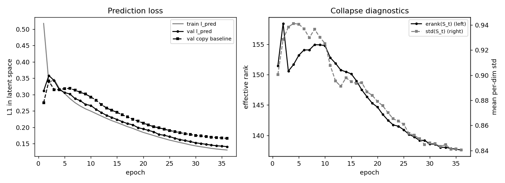

*Hình 4.1. Đường học của world model trên tập train và validation.*

## 4.2 Biểu diễn không sụp

Độ lệch chuẩn trung bình theo chiều của $S_t$ là 0,836, so với 0,234 của encoder khởi tạo ngẫu nhiên, và hạng hiệu dụng là 138,4 trên 256 chiều. Hạng hiệu dụng của encoder ngẫu nhiên (143,3) thậm chí cao hơn, nên thước đo này chỉ cho biết **không có sụp** (giá trị lớn hơn nhiều so với ngưỡng 20), không chứng minh chất lượng. Chất lượng được đánh giá bằng probe ở mục 4.4.

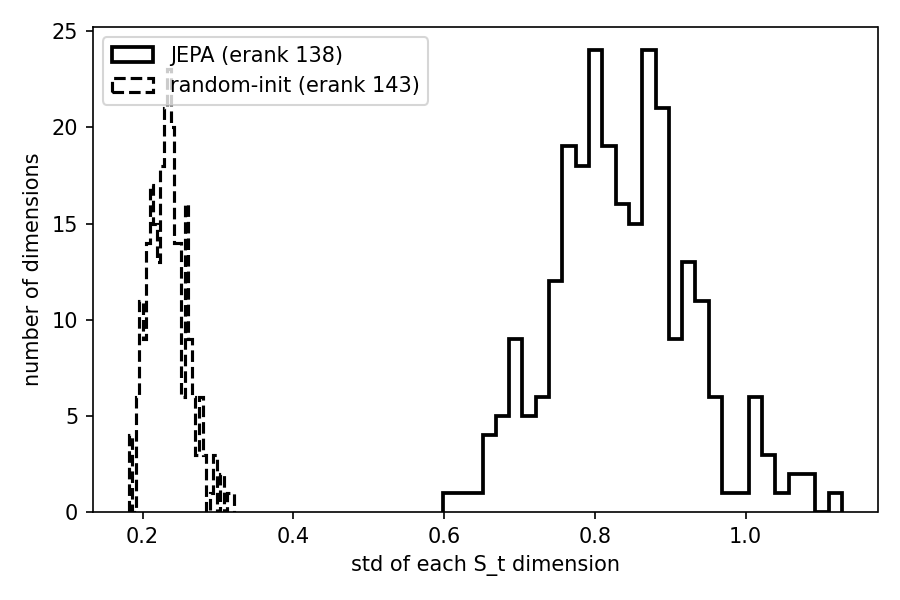

*Hình 4.2. Phân bố độ lệch chuẩn theo chiều của $S_t$ trên tập validation.*

## 4.3 Sai số dự đoán theo số bước k

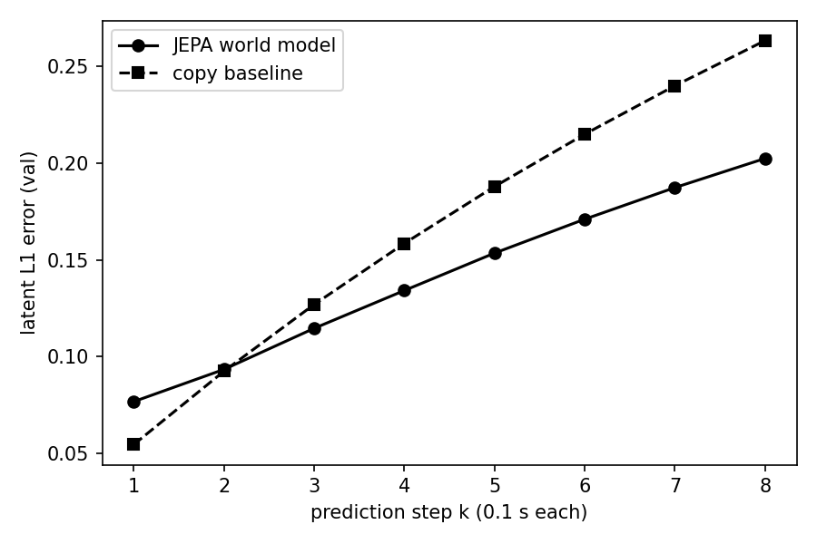

*Hình 4.3. $\mathcal{L}_{pred}$ của world model và của baseline copy theo số bước dự đoán $k = 1..8$.*

Predictor **thua copy ở $k = 1, 2$** (0,077 so với 0,055 và 0,093 so với 0,092) và thắng từ $k = 3$, chênh lệch tăng dần: tại $k = 8$ là 0,202 so với 0,263. Ở horizon ngắn, hai khung liền kề gần như trùng nhau nên "không đổi" là dự đoán rất mạnh; ở horizon dài, ảnh hưởng của hành động tích lũy và mô hình có lợi thế rõ. Đây là một tiêu chí chưa đạt trong kế hoạch ban đầu và được ghi nhận như một ngoại lệ.

## 4.4 Linear probe

Ridge tuyến tính ($\alpha = 1$) khôi phục tư thế khối T từ $S_t$, huấn luyện trên tập train và chấm trên tập validation.

*Bảng 4.1. Probe tuyến tính (validation).*

| Biểu diễn | $R^2$ vị trí khối T | $R^2$ góc (trung bình cos, sin) | Sai số vị trí (px, thang 512) | Sai số góc (độ) |
|---|---|---|---|---|
| JEPA $S_t$ | **0,904** | **0,595** | **20,8** | **18,5** |
| Encoder ngẫu nhiên | 0,687 | -0,046 | 40,4 | 40,5 |
| PCA 256 chiều trên pixel | 0,821 | -0,124 | 28,1 | 42,8 |

$S_t$ chứa thông tin tư thế tốt hơn hẳn cả hai đối chứng, và vượt trội nhất ở góc. Nhưng $R^2$ góc 0,595 vẫn thấp: $R^2$ của $\cos\theta$ chỉ 0,474 (của $\sin\theta$ là 0,717), và sai số 18,5° còn lớn so với yêu cầu căn khít cuối.

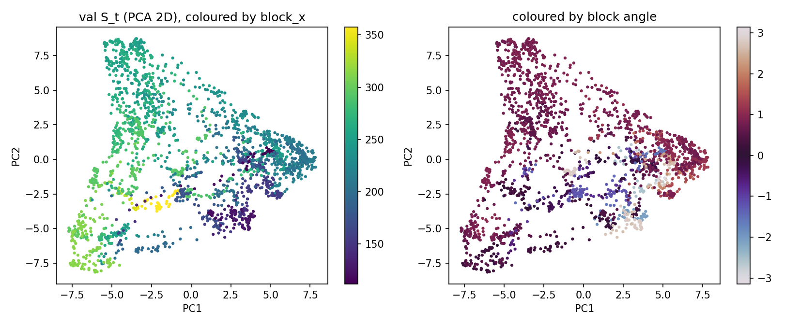

*Hình 4.4. Chiếu PCA của $S_t$ trên tập validation, tô theo tư thế khối T.*

## 4.5 Sai số ở mức vật lý

Để quy đổi dự đoán của predictor về pixel, ta đưa $\hat z_{t+k}$ qua probe. Đối chứng công bằng là "không động lực": đưa chính $S_t$ qua probe để đoán tư thế tại $t+k$.

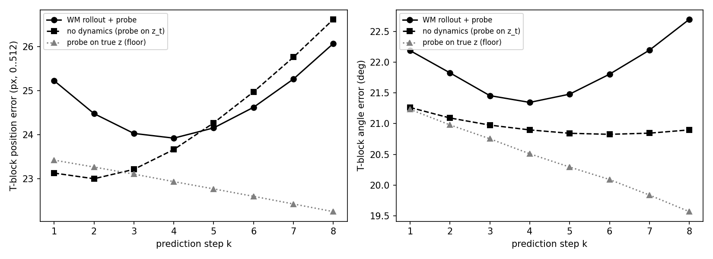

*Hình 4.5. Sai số tư thế khối T theo $k$: world model + probe, baseline không động lực, và sàn của probe (probe trên latent thật).*

Tại $k = 8$, world model cho 26,1 px và 22,7° so với 26,6 px và 20,9° của baseline không động lực. Về vị trí, world model chỉ hơn từ $k = 7$ và hơn dưới 1 px; về góc, kém hơn ở mọi $k$. Sai số của cả hai bị chặn bởi sàn của probe (khoảng 22 px và 20°). **Kết luận:** qua probe tuyến tính, chưa chứng minh được predictor học động lực vật lý tốt hơn việc giữ nguyên trạng thái. Bằng chứng cho động lực nằm ở $\mathcal{L}_{pred}$ thắng copy từ $k = 3$, và bằng chứng cho giá trị của biểu diễn nằm ở các kết quả downstream của Chương 5.

# Chương 5. Kết quả chính sách và ablation

## 5.1 Huấn luyện DiT

DiT (1 355 778 tham số) huấn luyện 300 epoch (27 300 bước, 1755 s trên GTX 1650); world model đóng băng, checksum trọng số không đổi trước và sau. Checkpoint tốt nhất ở epoch 240. Trước khi huấn luyện đầy đủ, mô hình overfit được một batch (loss 0,0166), xác nhận mã nguồn đúng.

Ở mức quỹ đạo của chính pusher (1855 mẫu validation), FDE sau 2 s của DiT là 63,6 px, so với 123,8 px (đứng yên) và 153,3 px (ngoại suy vận tốc). Tốc độ trung bình của DiT là 91,7 px/s, chậm hơn khoảng 13% so với người (105,3 px/s).

## 5.2 FDE offline trên tư thế vật thể

Với 375 mẫu validation (bước trượt 5 khung, horizon 20), ta chạy path dự đoán trong sim và đo tư thế khối T (mục 3.7). Sai số nền của phép đo (sim so với bản ghi) chỉ 0,07 px.

*Bảng 5.1. FDE tại 2 s (pixel; độ cho $\theta$).*

| Cấu hình | FDE$_{pos}$ | FDE$_\theta$ | FDE$_{obj}$ | minFDE@5 (pos / obj) |
|---|---|---|---|---|
| **DiT (chính)** | **22,6** | **14,0** | **37,2** | 11,8 / 21,2 |
| Ngoại suy vận tốc | 27,1 | 16,7 | 44,6 | - |
| Đứng yên | 31,7 | 18,9 | 51,5 | - |
| A2: không dùng vị trí pusher | 24,2 | 14,8 | 39,8 | 12,6 / 22,8 |
| A1: encoder khởi tạo ngẫu nhiên | 34,2 | 21,5 | 56,7 | 15,9 / 30,3 |

DiT chính giảm FDE$_{obj}$ 16,6% so với ngoại suy vận tốc và 27,8% so với đứng yên. A1 tệ hơn **cả hai baseline**, nghĩa là DiT huấn luyện trên latent ngẫu nhiên không học được gì hữu ích. minFDE@5 gần bằng một nửa FDE trung bình, cho thấy các mẫu sinh ra thực sự đa dạng.

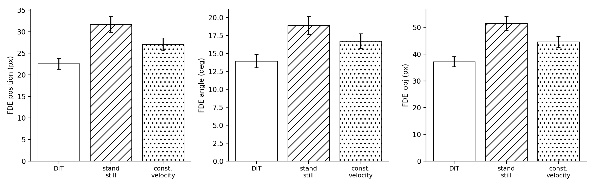

*Hình 5.1. FDE offline của DiT và hai baseline (trung bình ± sai số chuẩn). Các mẫu cùng tập validation có tương quan, nên khoảng tin cậy thực rộng hơn thanh sai số.*

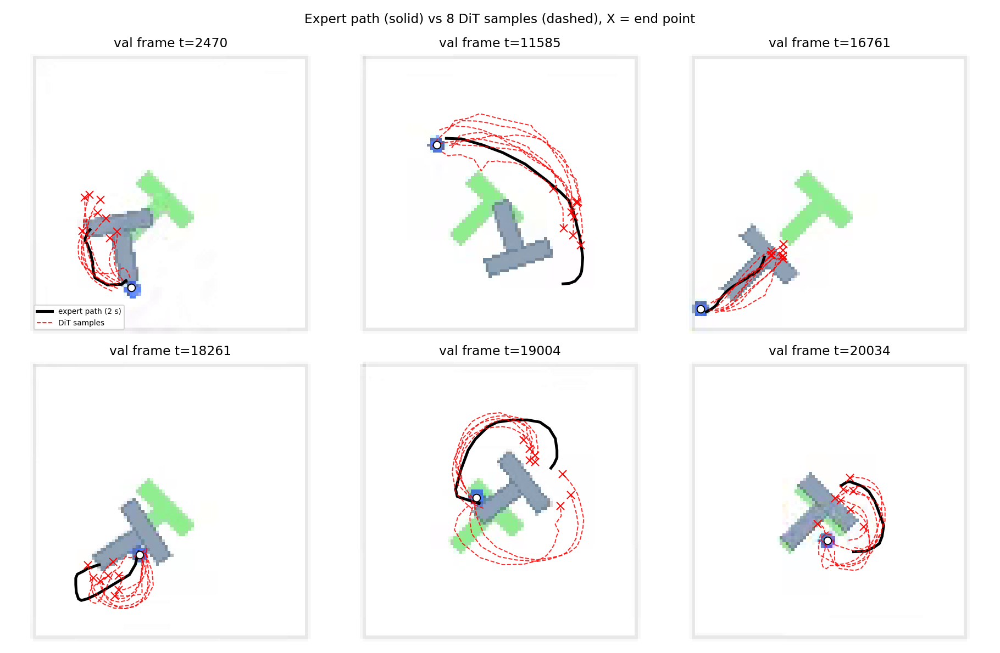

*Hình 5.2. Các quỹ đạo DiT sinh ra (nhiều mẫu) chồng lên quỹ đạo của người.*

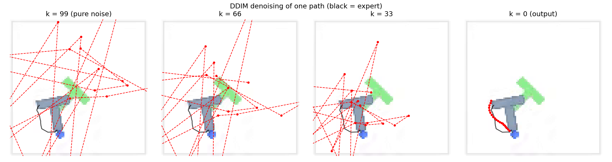

*Hình 5.3. Quá trình khử nhiễu từ nhiễu Gaussian tới quỹ đạo cuối.*

## 5.3 Mô phỏng vòng kín

Mỗi cấu hình chạy 50 tập, seed từ 100000, tối đa 300 bước (30 s), cùng bộ seed cho mọi cấu hình. Khoảng tin cậy là khoảng Wilson 95%.

*Bảng 5.2. Kết quả vòng kín (50 seed).*

| Cấu hình | Success@0,95 (khoảng tin cậy 95%) | Success@0,90 | Mean max coverage | Thời gian median tới thành công (s) | Độ trễ (ms) |
|---|---|---|---|---|---|
| **Chính** (8 bước thực thi, DDIM 16) | **26% (16 đến 40%)** | 50% | 0,776 | 16,3 | 117 |
| A1: encoder ngẫu nhiên | 0% (0 đến 7%) | 0% | 0,269 | - | 101 |
| A2: không dùng vị trí pusher | 32% (21 đến 46%) | 52% | 0,657 | 19,3 | 111 |
| A3: 4 bước thực thi | 20% (11 đến 33%) | 36% | 0,652 | 22,0 | 112 |
| A3: 6 bước thực thi | 32% (21 đến 46%) | 52% | 0,744 | 18,2 | 108 |
| A3: 12 bước thực thi | 18% (10 đến 31%) | 54% | 0,780 | 23,3 | 108 |
| A4: DDIM 4 bước | 16% (8 đến 29%) | 32% | 0,655 | 16,9 | 35 |
| A4: DDIM 8 bước | 22% (13 đến 35%) | 58% | 0,799 | 26,1 | 63 |

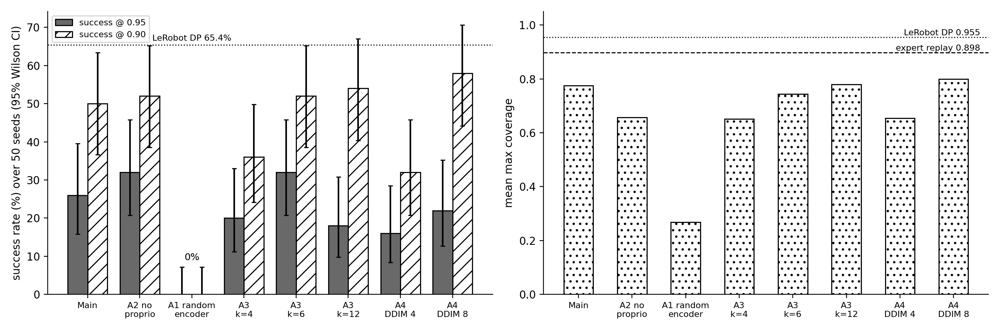

*Hình 5.4. Success@0,95, success@0,90 và mean max coverage của các cấu hình (khoảng Wilson 95%). Đường chấm: kết quả LeRobot Diffusion Policy; đường đứt: replay demo của người.*

**Đọc kết quả.** Chỉ có một khác biệt phân biệt được với nhiễu: **A1 so với cấu hình chính** (0/50 so với 13/50, kiểm định Fisher p = 0,0001). Mọi khác biệt còn lại có p > 0,3, nên các cấu hình A2, A3, A4 **không phân biệt được** với cấu hình chính bằng 50 seed, dù có số khác nhau. Hai quan sát đáng ghi: DDIM 8 bước cho kết quả tương đương 16 bước với độ trễ giảm gần một nửa (63 ms so với 117 ms), và 4 bước thực thi (chọn lại kế hoạch quá thường xuyên) có mean max coverage thấp nhất trong nhóm A3 (0,652). Cấu hình chính giữ 8 bước thực thi vì đó là giá trị mặc định của Diffusion Policy, không chọn theo kết quả của chính bộ seed này.

## 5.4 Thời gian hoàn thành và một ca điển hình

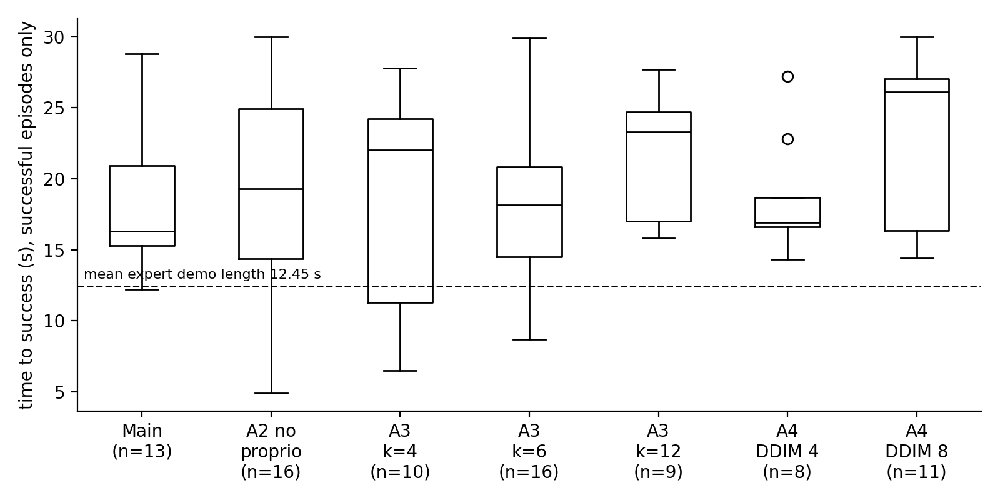

*Hình 5.5. Phân bố thời gian hoàn thành của các tập **thành công** (n = 8 đến 16 mỗi cấu hình). Đường đứt: độ dài trung bình demo của người, 12,45 s.*

Hình 5.5 chỉ tính tập thành công và bị cắt ở 30 s, nên không dùng để so tốc độ giữa các cấu hình. Median 16,3 s của cấu hình chính gần với độ dài demo của người (12,45 s).

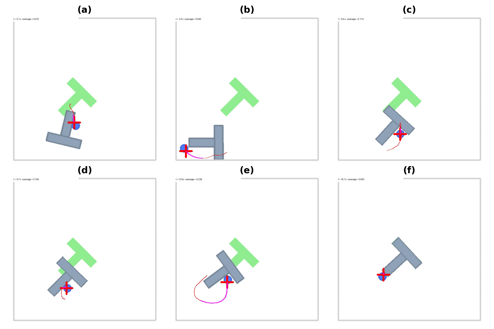

*Hình 5.6. Một tập thành công (seed 100001) theo thời gian: (a) 0,1 s, coverage 0,010; (b) 3,3 s, 0,000; (c) 6,5 s, 0,114; (d) 9,7 s, 0,159; (e) 12,9 s, 0,228; (f) 16,1 s, 0,953. Đường đỏ mảnh: toàn bộ quỹ đạo 20 điểm DiT dự đoán; đường hồng đậm: 8 điểm đầu được thực thi trước khi dự đoán lại.*

Ở (b), khối T bị đẩy ra xa đích và coverage về 0. Chính sách tiếp tục đẩy, đưa khối quay lại và đạt 0,953 ở 16,1 s. Đây là một ca tự sửa lỗi; nó không chứng minh hành vi này xảy ra thường xuyên.

## 5.5 Kiểm tra độc lập trên 20 seed mới

Để loại khả năng cấu hình được chọn theo bộ seed đánh giá, chạy thêm 20 seed mới (1000 đến 1019, cấu hình DDIM 8 bước) bằng chương trình demo. Kết quả: **5/20 thành công (25%)**, mean max coverage 0,724, so với 26% và 0,776 của bộ chính. Gộp 70 tập, tỷ lệ thành công là 18/70 = 25,7% (khoảng Wilson 17 đến 37%). Toàn bộ log theo seed nằm trong `outputs/demo/live_log.csv` và video từng seed trong thư mục `media/live/` của kho mã.

## 5.6 Tóm tắt các kết luận được ủng hộ

- Encoder JEPA mang thông tin hữu ích cho điều khiển: A1 giảm success từ 26% xuống 0% (p = 0,0001) và đẩy FDE$_{obj}$ lên 56,7, tệ hơn cả đứng yên.
- DiT dự đoán chuyển động vật thể tốt hơn hai baseline đơn giản (FDE$_{obj}$ 37,2 so với 44,6 và 51,5).
- Các ablation A2, A3, A4 không cho thấy khác biệt có ý nghĩa với 50 seed.

# Chương 6. Thảo luận và hạn chế

## 6.1 Kết quả ủng hộ điều gì, và tới mức nào

Bảng 6.1 tách các nhận định của báo cáo theo độ mạnh của bằng chứng. So sánh tỷ lệ thành công dùng kiểm định chính xác Fisher trên 50 seed. Kiểm định này chưa tận dụng việc các cấu hình chạy trên cùng bộ seed, nên kết quả thiên về thận trọng.

*Bảng 6.1. Các nhận định chính và độ mạnh bằng chứng.*

| Nhận định | Bằng chứng | Độ mạnh |
|---|---|---|
| Biểu diễn JEPA chứa thông tin dùng được để điều khiển | Encoder ngẫu nhiên (A1): 0/50 so với 13/50 (p = 0,0001); FDE$_{obj}$ của A1 là 56,7, tệ hơn cả baseline đứng yên (51,5); probe vị trí $R^2$ 0,904 so với 0,687 | Mạnh |
| DiT dự đoán chuyển động vật thể tốt hơn baseline đơn giản | FDE$_{obj}$ 37,2 so với 44,6 (ngoại suy vận tốc, giảm 16,6%) và 51,5 (đứng yên, giảm 27,8%) | Mạnh (offline) |
| Bỏ proprio (chỉ dùng ảnh) không làm giảm hiệu năng | Success 32% so với 26% (p = 0,66), nhưng mean max coverage giảm từ 0,776 xuống 0,657 và FDE$_{obj}$ tăng từ 37,2 lên 39,8 | Chưa kết luận được |
| Số bước thực thi và số bước DDIM ảnh hưởng tới success | Mọi so sánh với cấu hình chính đều có p > 0,3; DDIM 8 bước cho kết quả tương đương 16 bước với nửa độ trễ (63 so với 117 ms) | Yếu: 50 seed không đủ để phân biệt |
| Predictor của world model dự đoán đúng động lực vật lý | $\mathcal{L}_{pred}$ thắng baseline copy từ $k = 3$ nhưng thua ở $k = 1, 2$; ở mức tư thế vật lý (qua probe) không hơn baseline không động lực (26,1 so với 26,6 px tại $k = 8$; góc kém hơn ở mọi $k$) | Không được ủng hộ |

Cần nói rõ giới hạn của nhận định mạnh nhất. A1 chứng minh rằng **việc huấn luyện** encoder bằng mục tiêu JEPA có tác dụng so với encoder ngẫu nhiên cùng kiến trúc. A1 **không** chứng minh JEPA tốt hơn các cách học biểu diễn khác như VAE hay encoder pretrained. Để chứng minh điều đó cần các ablation A6 và A7, chưa thực hiện.

## 6.2 Khoảng cách với Diffusion Policy gốc

Gộp 50 seed đánh giá và 20 seed demo độc lập, tỷ lệ thành công là 18/70 = 25,7% (khoảng tin cậy Wilson 95%: 16,9% đến 37,0%). Con số 65,4% của Diffusion Policy trong LeRobot nằm ngoài khoảng này, nên đây là khoảng cách thật, không phải nhiễu thống kê. Ở ngưỡng 0,90, ứng với mức demo của người, policy thành công 50% (36,6% đến 63,4%), bằng tỷ lệ của chính các demo khi replay trên 20 tập val (10/20). Hai con số này đo trên hai bộ trạng thái đầu khác nhau nên chỉ có giá trị tham khảo.

Các khác biệt giữa project này và Diffusion Policy gốc có thể giải thích khoảng cách. Chưa yếu tố nào được kiểm tra riêng:

1. **Encoder không học theo mục tiêu điều khiển.** Diffusion Policy huấn luyện encoder ảnh end-to-end cùng hàm mất mát khử nhiễu. Ở đây encoder chỉ học dự đoán latent rồi bị đóng băng, nên không có tín hiệu nào báo cho encoder biết chi tiết nào cần cho bước căn khít cuối.
2. **Thông tin góc yếu.** Probe góc đạt sai số 18,5°, $R^2$ của $\cos\theta$ chỉ 0,474. Đạt coverage 0,95 đòi hỏi góc chính xác cỡ vài độ. Hình PCA (Hình 4.4) cho thấy phần lớn khung có góc quanh 0,8 rad, gần góc đích $\pi/4 \approx 0{,}785$ rad. Nếu đúng vậy, phương sai góc trong dữ liệu nhỏ và $R^2$ thấp một phần do phân phối dữ liệu, không hẳn do encoder. Nhận định này cần histogram góc để xác nhận.
3. **Demo không chứa đoạn căn khít cuối.** Demo dừng ở coverage khoảng 0,90, nên ngưỡng 0,95 nằm ngoài những gì policy được xem. Giả thuyết này nhất quán với việc 7/20 seed demo dừng ở coverage 0,88 đến 0,95, nhưng **chưa được kiểm chứng** bằng thí nghiệm.
4. **Quy mô nhỏ.** Hệ thống có 1,36 triệu tham số, 186 tập train, mỗi cấu hình chỉ huấn luyện một lần.

Khác biệt miền giữa ảnh sim và ảnh dataset ít khả năng là nguyên nhân chính. Ảnh render lệch dataset trung bình 0,7/255, và kiểm tra miền trên latent cho cosine 0,985. Tuy vậy, latent rất nhạy với dịch ảnh (cosine giữa bản sạch và bản dịch chỉ 0,415), nên không loại trừ hoàn toàn yếu tố này.

## 6.3 Phân tích lỗi

*Bảng 6.2. Phân loại 20 seed demo độc lập (1000 đến 1019) theo coverage lớn nhất.*

| Nhóm | Số seed | Coverage lớn nhất | Diễn giải |
|---|---|---|---|
| Thành công | 5 | ≥ 0,95 | |
| Gần xong | 4 | 0,92 đến 0,95 | đẩy đúng vùng, căn không khít |
| Ở mức demo | 3 | 0,88 đến 0,89 | tương đương điểm dừng của người |
| Thất bại | 8 | dưới 0,75 (thấp nhất 0,12) | chưa phân tích |

Nhóm gần xong và nhóm ở mức demo (7/20) phù hợp với yếu tố 2 và 3 ở mục 6.2: policy đưa được khối T về đích nhưng thiếu độ chính xác cuối. Nhóm thất bại (8/20) chưa được giải thích. Nhóm này cần xem từng video để phân biệt pusher đứng yên, đẩy sai hướng hay mất tiếp xúc. Ca thành công seed 100001 (Hình 5.6) cho thấy policy có khả năng tự sửa: ở 3,3 s khối T bị đẩy xa đích, coverage về 0, sau đó policy đưa khối về và đạt 0,953 ở 16,1 s. Ở chiều ngược lại, ca thất bại seed 100000 đạt coverage lớn nhất 0,726 trong 30 s nhưng không căn được.

## 6.4 Vai trò thật của world model

Trong vòng điều khiển, DiT chỉ dùng $S_t$ từ encoder; bộ dự đoán động lực không tham gia. Vì vậy hai kết quả sau không mâu thuẫn: predictor không hơn baseline không động lực ở mức vật lý, nhưng policy dùng $S_t$ lại thành công 26% so với 0% của encoder ngẫu nhiên. Mục tiêu dự đoán đóng vai trò **tín hiệu huấn luyện** định hình encoder; chất lượng của chính predictor ít ảnh hưởng tới policy.

Kết quả thua copy ở $k = 1, 2$ có lời giải thích hợp lý: hai khung liền kề gần như trùng nhau, nên "không thay đổi gì" là dự đoán rất mạnh ở horizon ngắn, còn predictor phải đi qua nút thắt $S_t$. Ở mức vật lý, sai số bị chặn bởi sàn của probe tuyến tính (khoảng 22 px, 20°). Thông tin động lực có thể nằm trong latent dưới dạng không đọc được bằng probe tuyến tính, nhưng project chưa có thí nghiệm kiểm tra điều đó.

Hệ quả là project **chưa khai thác khả năng dự đoán** của world model. Hướng tự nhiên là dùng predictor để lập kế hoạch trong không gian ẩn, kiểu MPC, như V-JEPA 2-AC [4]. Hướng này đòi hỏi predictor chính xác hơn hiện tại.

## 6.5 Mối đe dọa tính hợp lệ

- **Cỡ mẫu.** Với 50 seed, khoảng tin cậy rộng khoảng ±12 điểm phần trăm; mọi khác biệt dưới khoảng 25 điểm giữa hai cấu hình đều không phân biệt được.
- **Một lần huấn luyện cho mỗi cấu hình.** Phương sai do seed huấn luyện chưa được đo, nên một phần chênh lệch giữa các cấu hình có thể đến từ ngẫu nhiên khi train.
- **Chỉ trong mô phỏng.** Không có thử nghiệm trên robot thật; sim tất định, không có nhiễu cảm biến hay trễ truyền thông.
- **Lựa chọn không theo kết quả.** Các siêu tham số được chốt trước khi đánh giá. Cấu hình chính giữ 8 bước thực thi dù 6 bước cho success cao hơn (32% so với 26%), vì chênh lệch nằm trong nhiễu. Điều này tránh việc chọn cấu hình theo chính bộ seed dùng để báo cáo.
- **Khả năng tái lập.** World model dừng tay ở epoch 36/40 và được huấn luyện ở fp32. Mã nguồn công bố đặt AMP tắt mặc định để khớp với cấu hình đó. Huấn luyện lại sẽ cho kết quả gần nhưng không trùng từng chữ số vì GPU không tất định, và mỗi cấu hình chỉ huấn luyện một lần.

# Chương 7. Kết luận và hướng phát triển

## 7.1 Kết luận

Báo cáo xây dựng được toàn bộ quy trình từ ảnh tới điều khiển: world model JEPA tự giám sát, đóng băng, rồi DiT sinh quỹ đạo, đánh giá bằng FDE offline và mô phỏng vòng kín. Bằng chứng mạnh nhất cho hiệu quả của biểu diễn học được là ablation encoder ngẫu nhiên (success 0%, FDE tệ hơn đứng yên). Hiệu năng vòng kín còn khiêm tốn: 26% trên 50 seed và 25% trên 20 seed độc lập, thấp hơn rõ rệt so với Diffusion Policy gốc (65,4%). Báo cáo không khẳng định nguyên nhân; các giả thuyết (encoder không học theo mục tiêu điều khiển, thông tin góc yếu, demo không chứa đoạn căn khít cuối) được trình bày ở Chương 6 như hướng cần kiểm chứng.

## 7.2 Hướng phát triển

1. **Phân tích thất bại.** 8 trong 20 seed độc lập thất bại hẳn (coverage dưới 0,75); xem từng video để xác định pusher đứng yên, đẩy sai hướng hay mất tiếp xúc, rồi mới chọn cách cải thiện.
2. **Ablation hồi quy (BC-MSE) thay DiT**, để định lượng lợi ích của khuếch tán mà hiện mới được lập luận.
3. **Thay encoder bằng V-JEPA 2 đóng băng** (Assran và cộng sự, 2025) và so sánh với encoder tự huấn luyện, để biết biểu diễn tiền huấn luyện quy mô lớn có cải thiện thông tin góc hay không.

# Tài liệu tham khảo

*Mỗi mục dưới đây đã được đối chiếu với trang gốc của nhà xuất bản hoặc arXiv ngày 23/11/2026.*

[1] C. Chi, S. Feng, Y. Du, Z. Xu, E. Cousineau, B. Burchfiel, S. Song, "Diffusion Policy: Visuomotor Policy Learning via Action Diffusion," *Robotics: Science and Systems (RSS)*, 2023, doi: 10.15607/RSS.2023.XIX.026. arXiv:2303.04137.

[2] Y. LeCun, "A Path Towards Autonomous Machine Intelligence," phiên bản 0.9.2, 27/06/2022. https://openreview.net/forum?id=BZ5a1r-kVsf

[3] M. Assran, Q. Duval, I. Misra, P. Bojanowski, P. Vincent, M. Rabbat, Y. LeCun, N. Ballas, "Self-Supervised Learning from Images with a Joint-Embedding Predictive Architecture," *CVPR*, 2023, pp. 15619-15629, doi: 10.1109/CVPR52729.2023.01499.

[4] M. Assran và cộng sự, "V-JEPA 2: Self-Supervised Video Models Enable Understanding, Prediction and Planning," arXiv:2506.09985, 2025.

[5] W. Peebles, S. Xie, "Scalable Diffusion Models with Transformers," *ICCV*, 2023, pp. 4195-4205. arXiv:2212.09748.

[6] J. Ho, A. Jain, P. Abbeel, "Denoising Diffusion Probabilistic Models," *NeurIPS*, 2020. arXiv:2006.11239.

[7] J. Song, C. Meng, S. Ermon, "Denoising Diffusion Implicit Models," *ICLR*, 2021. arXiv:2010.02502.

[8] J.-B. Grill và cộng sự, "Bootstrap Your Own Latent: A New Approach to Self-Supervised Learning," *NeurIPS*, 2020. arXiv:2006.07733.

[9] A. Bardes, J. Ponce, Y. LeCun, "VICReg: Variance-Invariance-Covariance Regularization for Self-Supervised Learning," *ICLR*, 2022. arXiv:2105.04906.

[10] Hugging Face, "LeRobot: Making AI for Robotics more accessible with end-to-end learning." https://github.com/huggingface/lerobot (bộ dữ liệu `lerobot/pusht`: https://huggingface.co/datasets/lerobot/pusht).
